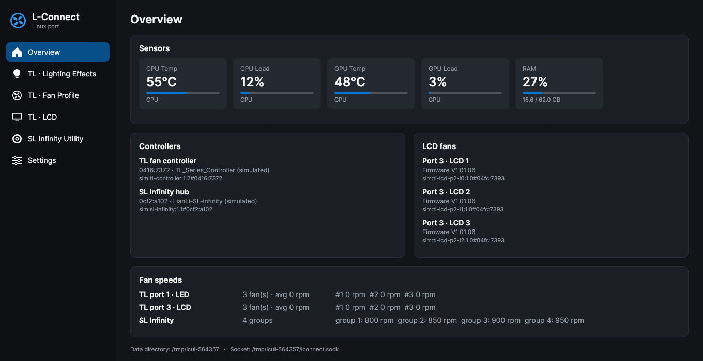
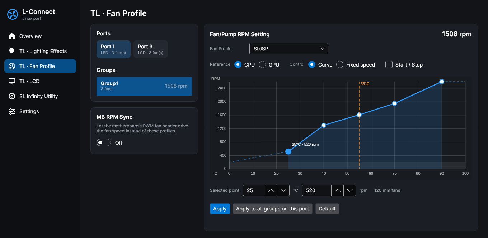
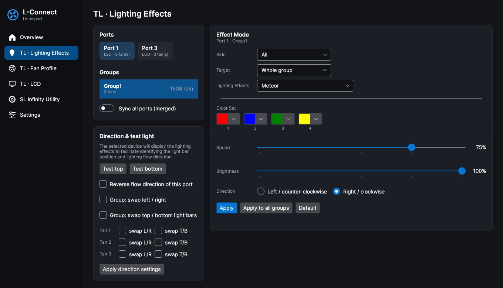

# L-Connect for Linux (unofficial)

[](https://github.com/koenhendriks/lian-li-lconnect-linux/actions/workflows/ci.yml)
[](https://aur.archlinux.org/packages/lconnect-linux)
[](https://aur.archlinux.org/packages/lconnect-linux-bin)
[](https://github.com/koenhendriks/lian-li-lconnect-linux/releases)

An unofficial Linux port of **Lian Li L-Connect 3 v2.0.11**. It drives UNI FAN **TL** fans (including the
**TL LCD** screens) and the **UNI HUB SL Infinity**: RGB effects, fan speed curves and the LCD screens (images, GIFs,
videos, built-in animations and the sensor gauges for CPU/GPU temperature and load, fan RPM and a combined CPU
temperature + load screen). The SL / AL / SL V2 / AL V2 hubs are ported too but have not been tested on real hardware.

It is a background service (`lconnectd`), a desktop GUI with a tray icon (`lconnect-ui`) and a command line tool
(`lconnectctl`).



| Fan curves | Lighting |
|---|---|
|  |  |

> **Not affiliated with Lian Li.** This port was made by decompiling the Windows application to make the
> hardware usable on Linux, and most of the code under `src/` is derived from it. No license is granted for that
> code. Lian Li's artwork (LCD animations, the sensor-screen web bundle whose fonts and artwork the gauges use, the
> logo) is not in this repository: you copy it from your own L-Connect 3 installation with `lconnectctl assets import`. "Lian Li", "L-Connect" and "UNI FAN"
> are trademarks of Lian Li Industrial Co., Ltd.

## Install

**Arch Linux:** install one of the AUR packages with any AUR helper:

- [`lconnect-linux-bin`](https://aur.archlinux.org/packages/lconnect-linux-bin): the release's prebuilt binaries, no
  build step (`yay -S lconnect-linux-bin`)
- [`lconnect-linux`](https://aur.archlinux.org/packages/lconnect-linux): builds the release from source with the .NET
  SDK and runs the tests (`yay -S lconnect-linux`)

Both install the same files and replace each other. To build the latest commit from a clone instead:

```sh
git clone https://github.com/koenhendriks/lian-li-lconnect-linux.git
cd lian-li-lconnect-linux/packaging/arch && makepkg -si
```

**Other distributions:** each [release](https://github.com/koenhendriks/lian-li-lconnect-linux/releases) has a
`linux-x64` tarball with the binaries in `lib/` (needs the .NET 10 and ASP.NET Core 10 runtimes, hidapi and ffmpeg) and
the systemd unit, udev rules, sysusers/tmpfiles and desktop files in `system/` to install by hand.

Then:

```sh
sudo usermod -aG lconnect "$USER"   # log out and back in afterwards

# Lian Li's LCD assets and (optionally) your Windows settings, e.g. from a Windows partition
lconnectctl assets import --from "/mnt/windows/Program Files/Lian-Li/L-Connect 3"
lconnectctl import --from "/mnt/windows/Program Files/Lian-Li/L-Connect 3/appdata"

sudo systemctl enable --now lconnectd
lconnect-ui
```

Optional package: `nvidia-utils` (NVIDIA GPU temperature and load).

Building from a clone uses its last **commit**, not uncommitted changes. Package upgrades restart `lconnectd`
themselves; restart the GUI as well (quit it from the tray).

`import` maps each Windows device to the connected Linux device with the same USB VID/PID/interface. Settings for
devices that are not plugged in are kept in `/var/lib/lconnect/pending/` and applied the first time the device
appears. Re-running `import` is safe.

## Everyday use

The GUI covers everything the original app does for these products. Closing the window keeps it in the tray, and
`lconnect-ui --background` starts it in the tray only (an autostart entry is installed). The same is available from
the command line:

```sh
lconnectctl status                                   # devices, LCDs, sensors
lconnectctl tl modes                                 # TL lighting modes/directions
lconnectctl tl lighting --port 2 --mode Meteor --speed 50 --brightness 100 --colors ff0080,00ff00
lconnectctl tl fan --port 2 --mode Quiet --source GPU
lconnectctl lcd show --port 2 --sensor GPUTemp --style 0 --bg 0000ff
lconnectctl lcd show --port 2 --sensor CPUTempLoad --style 0   # CPU temperature, load below it and on the ring
lconnectctl lcd show --port 2 --animation <name>     # names from: lconnectctl lcd animations
lconnectctl lcd show --port 2 --image ~/Pictures/x.png
lconnectctl lcd show --port 2 --video ~/Videos/x.mp4
```

The GUI does not notice changes made with `lconnectctl` while its LCD page is open; reopen the page before
changing anything there, or it writes back what it showed.

### How the LCD works

The TL LCD is a 400×400 screen that only accepts JPEG frames over USB HID (report 2, 512-byte packets). Everything
it shows is turned into JPEGs on the PC: images are sent once, videos and animations are decoded by ffmpeg and
streamed, and the sensor gauges are drawn with SkiaSharp the way Lian Li's web page draws them, using the page's
fonts, masks and artwork from the imported assets (no browser involved). A gauge is only redrawn when its value
changes; between readings, which arrive every 2 s, the ring eases to the new value instead of jumping. If `lconnectd`
stops, the screen keeps its last frame (or the boot image stored in the fan).

The daemon streams at 25 fps like Windows. Measured on a TL LCD (firmware V1.01.06), the fan completes at most one
frame per ~29.5 ms, about **34 fps**, whatever the frame size or the requested rate. To stream at 30 fps instead, add
a drop-in with `sudo systemctl edit lconnectd`:

```ini
[Service]
Environment=LCONNECT_LCD_FPS=30
```

Imported videos keep their own frame rate (up to 60) and are resampled to the stream rate during playback.

## How it differs from Windows

| Windows L-Connect | This port |
|---|---|
| Vendor-patched `hidapi.dll` with USB location fields | Standard `libhidapi-hidraw`; location from sysfs; writes padded to the report length like Windows does |
| Device identity = Windows HID path | Stable id from PCI host + USB port chain, e.g. `usb-0000:0a:00.0-8.2.3.3:1.2#0416:7372` (survives reboots as long as cables stay on the same headers) |
| WMI device watcher | Polling `hid_enumerate` once per second |
| CPUID SDK / GPU-Z sensors | hwmon `k10temp` Tctl (AMD) / `coretemp`, `/proc/stat`, NVML (NVIDIA), amdgpu hwmon |
| CefSharp off-screen browser for sensor gauges | Drawn natively with SkiaSharp after the same web bundle, redrawn only when a value changes |
| Gauge ring jumps to each new reading | Ring eases between readings; extra CPU Temp + Load screen |
| FFmpeg.AutoGen (bundled ffmpeg 6 DLLs) | `ffmpeg`/`ffprobe` command line |
| Windows service + watchdog, encrypted localhost HTTP | systemd service, same JSON requests over `/run/lconnect/lconnect.sock` |
| WPF UI | Avalonia UI with a StatusNotifierItem tray icon (works with Omarchy, KDE, waybar and other SNI hosts) |
| Firmware updater, Galahad / Strimer products | Not ported (firmware updates intentionally left out) |

## Files

- `/var/lib/lconnect` (group `lconnect`, setgid, 2770): `device/` and `profile/` use the same gzip-JSON formats and
  md5 naming as Windows' `appdata`; `repo/` holds converted LCD media, `assets/` the imported Lian Li web bundle and
  logo, `pending/` imported settings waiting for a device.
- `/run/lconnect/lconnect.sock`: daemon API (group `lconnect`).
- Logs: `journalctl -u lconnectd`. Raw HID traffic: set `LCONNECT_HID_LOG=/tmp/hid.log` in a drop-in.

## Troubleshooting

- **`lconnectctl status` cannot reach lconnectd**: check `systemctl status lconnectd` and that you are in the
  `lconnect` group (`id`).
- **No devices**: `lconnectctl devices` lists the hidraw interfaces; the udev rule must have given them group
  `lconnect` (`ls -l /dev/hidraw*`). Reload with `sudo udevadm trigger -s hidraw`.
- **Device ids look like `hid-hidraw17#0416:7372`**: the sysfs location could not be read, and settings will not
  survive a reboot. Builds before the stable-id fix did this; on the first start of a fixed build the daemon adopts
  the newest of those settings (`journalctl -u lconnectd | grep Adopted`).
- **LCD gauge without its ticks, segments or needle**: import the assets; the gauges draw their artwork from them.
- **LCD wrong port mapping**: the LCD fan reports its own port/index; `lconnectctl probe` (with lconnectd stopped)
  shows what the firmware says.
- **Fan curve uses 0 °C**: no CPU sensor found; `journalctl -u lconnectd | grep "CPU temperature source"`. On AMD the
  `k10temp` module provides it.
- **No tray icon**: the bar needs a StatusNotifierItem host (`busctl --user list | grep StatusNotifierWatcher`).

## Development

| Path | What it is |
|---|---|
| `src/LConnect.Core` | Port of `L-Connect.Core.dll`: HID protocol for the TL controller (report 1, 64 B), TL LCD (report 2, 512 B), ENE hubs (report 0xE0), settings storage, media conversion |
| `src/LConnect.Daemon` → `lconnectd` | Port of the Windows service: applies settings, runs fan curves every second, streams LCD frames, hot-plug, sensors |
| `src/LConnect.App` | Non-visual logic from `L-Connect 3.exe` (controllers, profiles, curve model), shared by GUI and CLI |
| `src/LConnect.Ui` → `lconnect-ui` | Avalonia desktop GUI |
| `src/LConnect.Cli` → `lconnectctl` | Command line |
| `packaging/arch` | PKGBUILD, systemd unit, udev rules, sysusers/tmpfiles, sleep hook, desktop files |
| `tests/` | Golden byte-for-byte tests against the original DLLs (87 scenarios), port tests and headless GUI tests |
| `tools/GoldenHarness` | net48 harness that runs the scenarios against the *original* Windows assemblies |

```sh
dotnet test tests/LConnect.Core.Tests          # golden + port tests (Windows and Linux)
dotnet test tests/LConnect.Ui.Tests            # headless GUI against the simulator; writes page screenshots
tools/linux-smoke-test.sh "<L-Connect 3 install dir>"          # end-to-end with the hardware simulator
tools/systemd-integration-test.sh "<L-Connect 3 install dir>"  # same, as a hardened systemd service (sudo)
```

- `LCONNECT_SIMULATE=1` replaces the hardware with a software TL controller (one LCD fan on port 2; configure with
  `LCONNECT_SIMULATE_TL="0:LED,LED;2:LCD"`), and `LCONNECT_SIMULATE_SLINF=1` adds an SL Infinity hub. Commands go to
  `<data>/sim/*.log`, LCD frames to `<data>/sim/*.jpg`. `LCONNECT_SIMULATE_LCD_DECODE_MS` makes the simulated LCD
  hold each frame's first packet that long after the previous frame, like a busy firmware.
- `LCONNECT_LCD_FPS` (default 25) sets the LCD stream rate; `LCONNECT_LCD_STATS=1` logs the achieved rate and HID
  write times every 5 s.
- `LCONNECT_FAKE_CPU_TEMP` / `LCONNECT_FAKE_GPU_TEMP` (or `<data>/sensor-override.json`) override sensor readings.
- `lconnectd --render-sensor out` renders every LCD gauge style with a few sample readings to `out.style<N>.<case>.jpg`.
- `LCONNECT_DATA_DIR`, `LCONNECT_SOCKET`, `LCONNECT_HIDAPI`, `LCONNECT_FFMPEG_DIR` override paths.
- On Windows the port can drive the real hardware for testing (stop the L-Connect services first) using L-Connect's
  own `hidapi.dll`: `LCONNECT_HIDAPI="C:\Program Files\Lian-Li\L-Connect 3\hidapi.dll"`.
- Regenerate the golden data after changing scenarios: build `tools/GoldenHarness` (Windows, needs an L-Connect 3
  install) and run it with `tests/fixtures/appdata tests/Golden/golden.txt`.
- Releasing: tag `v<L-Connect version>.<port release>` (e.g. `git tag v2.0.11.2`) and push the tag to GitHub.
  The release workflow runs CI, builds the binaries, source tarball and Arch package, publishes a GitHub release
  whose notes list the commits since the previous tag, and pushes the generated PKGBUILDs (`tools/aur-pkgbuild.sh`,
  `--bin` for `lconnect-linux-bin`) to the AUR with the `AUR_SSH_PRIVATE_KEY` secret.
- New L-Connect version: decompile the old and new versions with `ilspycmd -p --nested-directories` into the
  git-ignored `vendor/` folder and diff them to see protocol changes. Decompiler output is never committed.
